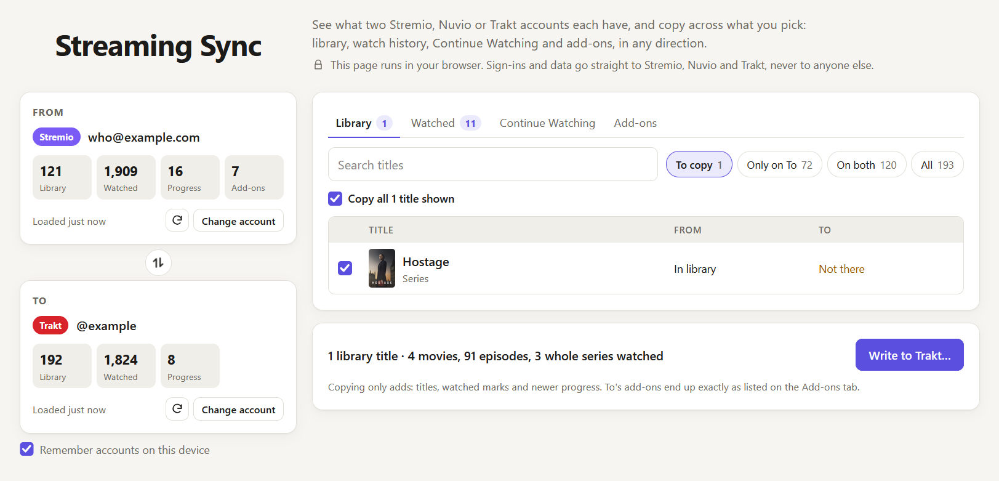
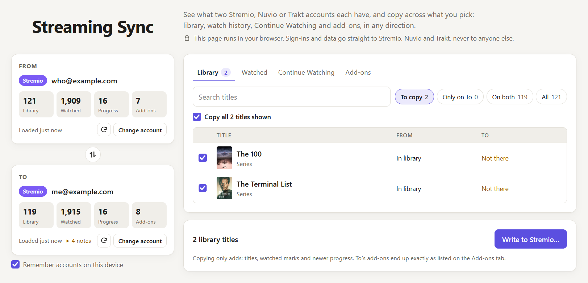

# Streaming Sync

A web page that shows what two streaming-app accounts each have, side by side, and copies across what you pick: library, watch history, Continue Watching progress and add-ons. It works in any direction:

- Stremio → Stremio (e.g. an old account to a new one)
- Stremio → Nuvio, Nuvio → Stremio
- Nuvio → Nuvio, including between two profiles of one account
- Trakt ↔ either of them, or Trakt → Trakt

It runs entirely in your browser. Sign-ins and data go straight from the page to Stremio, Nuvio and Trakt, whose APIs accept requests from any web page. There is no server, so it can be hosted as static files anywhere.

**Use it:** https://luisfavila.github.io/streaming-sync/



## Using it

1. **From:** sign in to the account to copy from. **To:** sign in to the account to copy to. Each side loads as soon as it's chosen and shows what it holds.
2. **Compare:** the Library, Watched and Continue Watching tabs list every title with what each side has. Filter by *To copy*, *Only on To*, *On both* or *All*, or search.
   - Everything To is missing starts ticked. Untick what you don't want; the selection is kept between writes, so you can sync a bit at a time.
3. **Add-ons:** From's add-ons are listed next to the list To will have after writing.
   - That list starts as To's own add-ons, followed by those From has and To lacks.
   - Reorder it (drag, or the arrows), remove add-ons, add one by URL, or switch one off (Nuvio only).
4. Press **Write**. The confirmation lists everything that will change, removals included.
   - Afterwards the page re-reads To and confirms everything arrived, or lists what didn't.

To keep two accounts in step both ways, sync once, press the swap button, and sync again.



### Signing in

| | Stremio | Nuvio | Trakt |
|---|---|---|---|
| **Link code** (recommended) | Shows a code; approve it in a browser where you're signed in to Stremio. Works with Facebook and Apple sign-in. | Shows a code; approve it at nuvio.tv/link. | **Sign in with Trakt** opens a Trakt window to approve in, where the page is set up for it (see below). Otherwise, or by choice, a code to enter on Trakt's activation page. |
| **Email & password** | The password goes only to Stremio. | The password goes only to Nuvio. | — |
| **Token** | Your `authKey`. On [web.stremio.com](https://web.stremio.com), signed in, run `copy(JSON.parse(localStorage.profile).auth.key)` in the browser console. | — | — |

Only session tokens are kept, never passwords. With **Remember accounts on this device** ticked, they're kept in this browser's localStorage; otherwise they're gone when you close the page. **Sign out** ends the session if this page created it. A pasted Stremio token's session is left alone.

For Nuvio accounts with several profiles, pick the profile on each side.

#### Trakt sign-in goes through an API app

Every request to Trakt's API names a Trakt "app" by its client ID. Since October 2026 Trakt no longer issues client secrets to new apps and doesn't require one to sign in ([trakt/trakt-api#974](https://github.com/trakt/trakt-api/pull/974)), so the client ID is all the page needs, and it's public by design. Either:

- **Build the page with one** (recommended when hosting): register one app at [trakt.tv/oauth/applications/new](https://trakt.tv/oauth/applications/new) and set `VITE_TRAKT_CLIENT_ID` when running `npm run build` (e.g. in `.env.local`). Visitors then just sign in with a code.
  - **Add "Sign in with Trakt"** (Trakt's recommended [PKCE](https://developer.trakt.tv/docs/pkce) sign-in): also set `VITE_TRAKT_REDIRECT_URI` to the page's exact `https://` address (e.g. `https://you.github.io/streaming-sync/`), and add that same address to the app's *Redirect uri* list on Trakt, next to `urn:ietf:wg:oauth:2.0:oob`. A Trakt window opens, the visitor approves, and the window hands the sign-in back to the page; no secret is involved. Signing in with a code stays available, and is all that's offered where the page runs from another address (e.g. `localhost` during development).
- **Use your own:** without a built-in one, the page asks for a client ID the first time you pick Trakt, and keeps it in your browser.

An older app that still has a secret can give it in the optional field when signing in; it's then sent along, which legacy apps may need. There's deliberately no build setting for a secret: anything set at build time ends up in the page's public JavaScript.

## What a sync does

Copying titles is additive. It adds what To is missing and never removes or un-watches anything:

| Data | Rule |
|---|---|
| Library | Ticked titles missing from To are added. |
| Watched | Movies and episodes watched on From are marked watched on To. |
| Continue Watching | Progress is copied when From's is newer for that title. If To is further along, it's left alone, and the row says why. |
| Add-ons | To's add-ons end up exactly as the Add-ons tab shows: in that order, switched on or off as shown. This is the one place a write can remove something. |

On Trakt, the library is the **watchlist**, watched is the **history**, and Continue Watching is **paused playback**. Trakt has no add-ons.

Add-ons that only run on one device (Stremio's Local Files) can't be copied. Stremio's built-in add-ons can't be removed, and Stremio has no on/off switch, so add-ons switched off on Nuvio aren't offered for Stremio by default.

## Development

Requires Node.js 22.18 or newer.

```sh
npm install
npm run dev        # local dev server
npm run build      # static site in dist/ (host it anywhere)
npm test           # unit + round-trip tests (node:test)
npm run e2e        # builds, then drives the page in headless Chromium against fake APIs
npm run typecheck
npm run lint       # Biome: lint + formatting check (npm run lint:fix to apply fixes)
```

Git hooks (Husky, installed by `npm install`):

- **pre-commit:** lint-staged runs Biome on the staged files and fixes what it safely can.
- **commit-msg:** commitlint checks the message follows [Conventional Commits](https://www.conventionalcommits.org/) (`feat:`, `fix:`, `chore:`, …).
- **pre-push:** lint, typecheck and tests over the whole project.

### Hosting on GitHub Pages

`.github/workflows/pages.yml` tests, builds and publishes the page on every push to `main`, at `https://<user>.github.io/<repo>/`. Once, in the repository's settings:

1. **Pages** → *Build and deployment* → *Source*: **GitHub Actions**.
2. Optional, for Trakt: **Secrets and variables** → **Actions** → **Variables**, add `VITE_TRAKT_CLIENT_ID` (and `VITE_TRAKT_REDIRECT_URI`, set to the page's address with its trailing `/`, for "Sign in with Trakt"). See [Trakt sign-in](#trakt-sign-in-goes-through-an-api-app). These are variables, not secrets: they end up in the page anyway.

Push to `main` (or run the workflow by hand from the **Actions** tab) to publish. The build uses relative paths, so the same files also work at a domain's root or any other sub-path.

`npm run e2e` needs `chromium` on the PATH. Every request to Stremio, Nuvio, Cinemeta and add-ons is answered by the in-memory fakes in `test/fakes.ts`, so no real account is touched.

### How it works

Each app has a provider that reads its data into a shared model (`src/model.ts`) and writes that model back. The planner (`src/sync/plan.ts`) compares two snapshots and lists what the target is missing; `src/sync/compare.ts` turns that into the side-by-side rows, the selection and the add-on list. The page lives in `src/web/`.

- **Stremio** keeps everything in library items (`api.strem.io` `datastoreGet` / `datastorePut`).
  - Watched episodes are a compressed bitfield over the series' episode list, which comes from Cinemeta. The codec in `src/providers/stremio/bitfield.ts` is a port of stremio-core's and is tested against its vectors.
  - Every write sets `_mtime` to now, so Stremio's apps pull the change instead of overwriting it.
- **Nuvio** is a Supabase backend (`api.nuvio.tv`). It uses the same per-profile RPCs as Nuvio's official app: `sync_pull_library` / `sync_push_library_items`, `sync_pull_watched_items` / `sync_push_watched_items`, `sync_pull_watch_progress` / `sync_push_watch_progress`, and `sync_push_addons`.
  - The add-on push replaces the whole list, which is what the add-on editor saves. Stored URLs of existing add-ons are kept as they are.
  - Refreshed tokens are saved straight away, because Nuvio's refresh tokens work only once.
- **Trakt** uses its public API (`api.trakt.tv`): `/sync/watchlist`, `/sync/watched` and `/sync/history`, `/sync/playback`, and `/scrobble/pause` to set a paused position. Writes are paced at one per second, as Trakt asks.
  - Trakt's history counts plays, so a write sends only what Trakt hasn't got; a whole-series mark is sent as the aired episodes still missing, never as the whole show (which would add a play to every episode).
- **Whole series watched:** Nuvio has a mark for this that Stremio and Trakt lack. A series with every aired episode watched on Stremio gets the mark on Nuvio. The mark from Nuvio becomes every aired episode on Stremio (specials excluded).

## Limits

- **Watch times:** Stremio stores one "last watched" time per series, not per episode. Episodes read from Stremio get that time for the latest episode, and their air date (when earlier) for the rest.
- **Episode lists:** watched episodes need the series' episode list from Cinemeta. Titles it doesn't cover (non-IMDb ids) keep their library entry and progress, but their watched episodes are skipped and reported.
- **Continue Watching on Nuvio:**
  - Nuvio doesn't store names or artwork for Continue Watching. The app looks them up through your add-ons, so titles need ids your add-ons understand.
  - Entries with an unknown video length are skipped for Nuvio, which would show them at 0%.
- **Nuvio settings:**
  - If Nuvio's watch progress source is set to Trakt or Simkl, the app ignores Nuvio's own sync data, so synced history may not show up there.
  - A Nuvio profile set to use the main profile's add-ons has none of its own; sync add-ons to the main profile.
- **Trakt:**
  - Only titles with an IMDb or TMDB id can be matched.
  - Trakt stores paused playback as a percentage. Reading it needs the runtime Trakt has for the title; writing it sets Trakt's paused time to the moment of the write.
  - Free Trakt accounts have limits (e.g. watchlist size); Trakt rejects writes beyond them.
- **Backup host:** Nuvio's backup host doesn't accept requests from web pages, so the page can't fall back to it during an outage.
- **Private APIs:** these are the apps' private APIs, the same ones their own apps use. They're undocumented and may change.

## Privacy and affiliation

There is no server: everything runs in your browser and goes only to the apps you sign in to. See the [privacy policy](https://luisfavila.github.io/streaming-sync/privacy).

Streaming Sync is not affiliated with Stremio, Nuvio or Trakt. Streaming Sync uses Trakt but is not endorsed or certified by Trakt.
